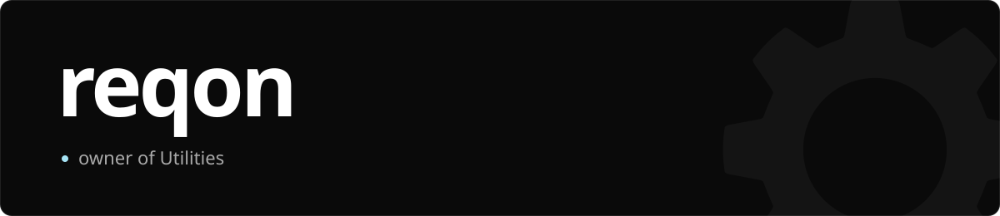
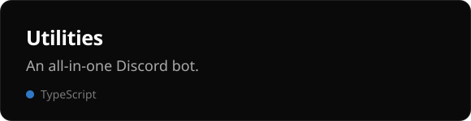
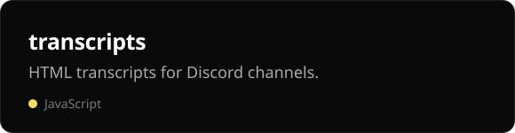
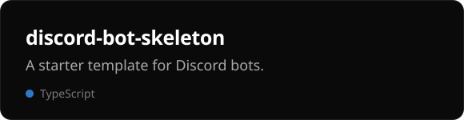
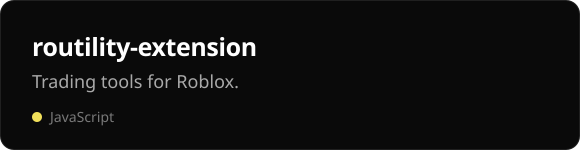

  <a href="https://utilities.best">Website</a>
  &nbsp;·&nbsp;
  <a href="https://utilities.best/invite">Add Utilities</a>
  &nbsp;·&nbsp;
  <a href="https://utilities.best/support">Support</a>

 

  
  
  
  

 

