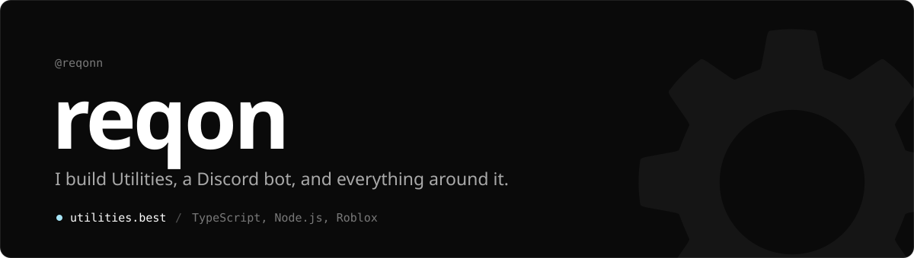
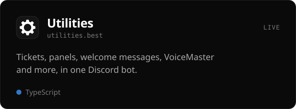
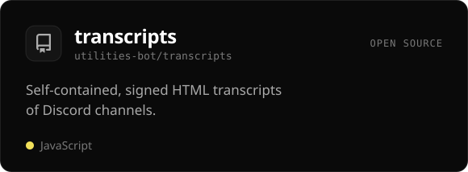
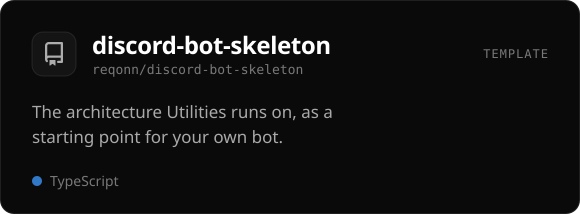
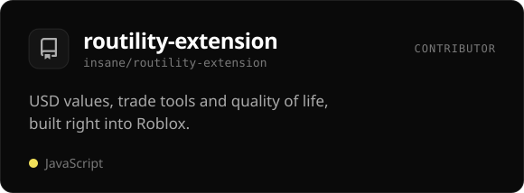
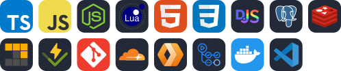
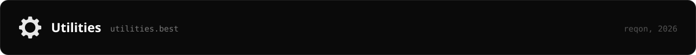

  <a href="https://utilities.best"><b>Website</b></a>
  &nbsp;&nbsp;·&nbsp;&nbsp;
  <a href="https://utilities.best/invite"><b>Add Utilities</b></a>
  &nbsp;&nbsp;·&nbsp;&nbsp;
  <a href="https://utilities.best/commands"><b>Commands</b></a>
  &nbsp;&nbsp;·&nbsp;&nbsp;
  <a href="https://utilities.best/support"><b>Support server</b></a>

 

I run **[Utilities](https://utilities.best)**, a Discord bot I write in TypeScript, along with its website, its status page and the tools it runs on. Most days that means Discord's API, Postgres and a lot of tests. I also make things for Roblox.

 

  
  
  
  

 

 

