 

I build **[Utilities](https://utilities.best)**, a Discord bot written in TypeScript, along with the website, the status page and the tools that run around it. I also make things for Roblox.

 

### Building

|                                                                                       |                                                                                                    |
| ------------------------------------------------------------------------------------- | -------------------------------------------------------------------------------------------------- |
| **[Utilities](https://utilities.best)**                                               | A Discord bot for tickets, panels, welcome messages, VoiceMaster and more.                         |
| **[`utilities-bot/transcripts`](https://github.com/utilities-bot/transcripts)**       | Self-contained, signed HTML transcripts of Discord channels.                                       |
| **[`reqonn/discord-bot-skeleton`](https://github.com/reqonn/discord-bot-skeleton)**   | The architecture Utilities runs on, as a starting point for your own bot.                          |
| **[`insane/routility-extension`](https://github.com/insane/routility-extension)**     | USD values, trade tools and quality of life, built right into Roblox.                              |
| **Shotgun Velocity**                                                                  | A velocity-based shooter on Roblox, with Way Too Crazy Games.                                      |

 

### Stack

  
  
  
  
  

  
  
  
  
  

  
  
  
  

 

### Elsewhere

