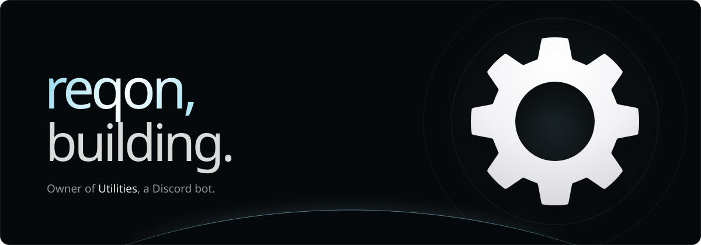
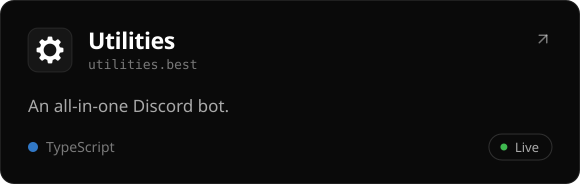
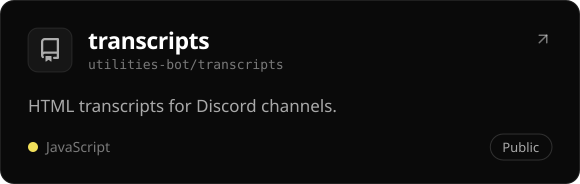
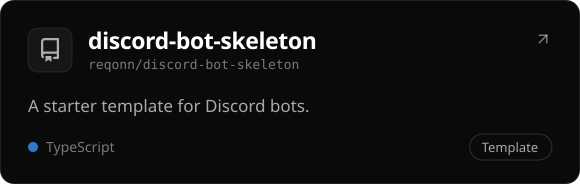
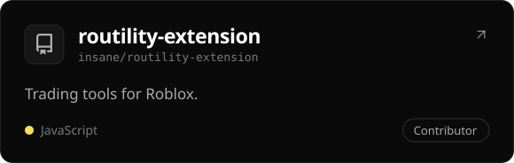

  &nbsp;
  &nbsp;
  

 

### About

Hey, I'm reqon. I make [Utilities](https://utilities.best), a Discord bot, and the website that goes with it. I mostly write TypeScript, and sometimes make things on Roblox.

 

### Projects

  
  
  
  

 

### Stack

