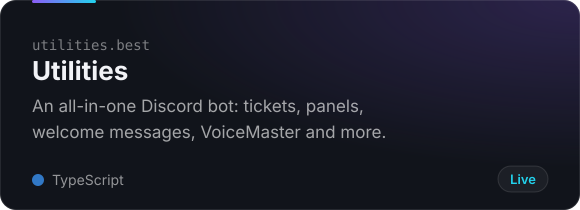
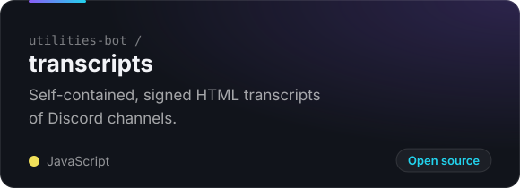
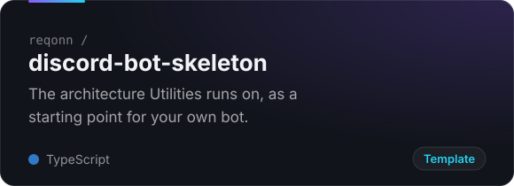
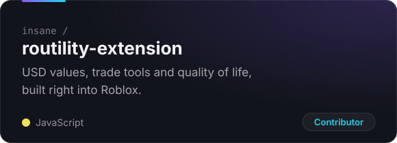

<a href="https://utilities.best">
  
</a>

<p align="center">
  <a href="https://utilities.best"></a>
  <a href="https://utilities.best/invite"></a>
  <a href="https://utilities.best/support"></a>
</p>


```ts
const reqon = {
  role: "Owner of Utilities",
  building: ["Utilities", "utilities.best", "discord-bot-skeleton"],
  writes: ["TypeScript", "JavaScript", "Luau"],
  runsOn: ["Node.js", "PostgreSQL", "Redis", "Railway", "Cloudflare Workers"],
  currently: "redesigning every command in Utilities",
};
```




<p align="center">
  <a href="https://utilities.best"></a>
  <a href="https://github.com/utilities-bot/transcripts"></a>
</p>
<p align="center">
  <a href="https://github.com/reqonn/discord-bot-skeleton"></a>
  <a href="https://github.com/insane/routility-extension"></a>
</p>


<p align="center">
  
  <br><br>
  
  <br><br>
  
</p>

<br>


